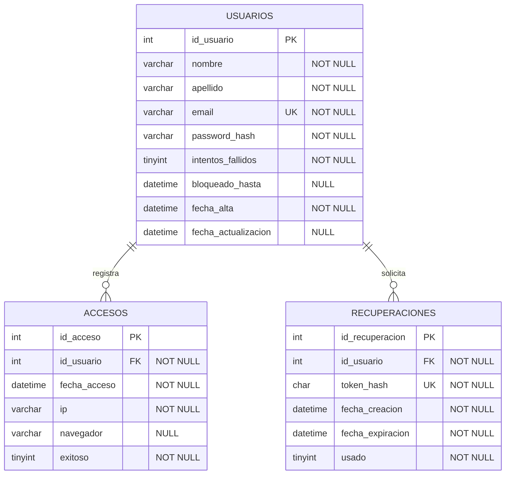

# Proyecto Login

| Dato | Detalle |
|------|---------|
| **Realizado por** | Ariana Tovar |
| **Materia** | Análisis de Sistemas |
| **Año de cursada** | 2026 |
| **Trabajo práctico** | TP — Proyecto Login |
| **Versión** | 1.0.0 |

Sistema web de autenticación de usuarios: inicio de sesión, alta de usuarios nuevos, recuperación de contraseña y una vista protegida (dashboard) con mensaje de bienvenida y cierre de sesión. Todos los datos se guardan en una base de datos relacional **MySQL**.

---

## Índice

1. [Tecnologías](#tecnologías)
2. [Funcionalidades](#funcionalidades)
3. [Pantallas](#pantallas)
4. [Estructura del proyecto](#estructura-del-proyecto)
5. [Instalación y ejecución (XAMPP)](#instalación-y-ejecución-xampp)
6. [Base de datos](#base-de-datos)
7. [Validaciones](#validaciones)
8. [Seguridad](#seguridad)
9. [Documentación UML](#documentación-uml)
10. [Prueba rápida](#prueba-rápida)

---

## Tecnologías

| Capa | Tecnología |
|------|------------|
| Front-end | HTML5, CSS3 (diseño responsive propio, sin frameworks) y JavaScript (ES6) |
| Back-end | PHP 8 con PDO |
| Base de datos | MySQL / MariaDB — puerto **3306** |
| Servidor | XAMPP — Apache en los puertos **80** y **443**, desde `localhost` (127.0.0.1) |
| Documentación | Diagramas UML en PDF (flujo, casos de uso y entidad-relación) |

## Funcionalidades

- **Iniciar sesión** con correo `@gmail.com` y contraseña.
- **Crear cuenta** con nombre, apellido, correo, contraseña y confirmación de contraseña.
- **Validación doble**: en el navegador (atributos `required`/`pattern` de HTML + JavaScript) y en el servidor (PHP).
- **Contraseña segura**: mínimo 8 caracteres, una mayúscula, una minúscula, un número y un símbolo, con una lista de requisitos que se tilda mientras se escribe.
- **Verificación de contraseñas**: el campo "Repetir contraseña" debe coincidir.
- **Mostrar/ocultar contraseña** con un botón en el campo.
- **Recuperar contraseña** ("¿Olvidaste la contraseña?") mediante un enlace temporal de 30 minutos.
- **Dashboard protegido** con el mensaje *"Bienvenido {nombre} a tu dashboard"*, los datos de la cuenta, el último ingreso y la actividad reciente.
- **Cerrar sesión** y volver al login.
- **Bloqueo temporal** de la cuenta (15 minutos) luego de 5 intentos fallidos.
- **Historial de accesos** (fecha, IP y resultado de cada inicio de sesión).
- **Cierre automático** de la sesión luego de 30 minutos de inactividad.
- **Diseño responsive**: se adapta a celulares, tablets y computadoras.

## Pantallas

| Archivo | Pantalla | Descripción |
|---------|----------|-------------|
| `index.php` | Iniciar sesión | Formulario de correo y contraseña, con los enlaces *"¿No tenés cuenta? Crear una"* y *"¿Olvidaste la contraseña?"* |
| `registro.php` | Crear Cuenta | Alta de usuario nuevo (los datos se guardan con un `INSERT` en la tabla `usuarios`) |
| `dashboard.php` | Dashboard | Vista protegida: solo se puede ver con la sesión iniciada |
| `recuperar.php` | Recuperar contraseña | Genera el enlace para restablecer la contraseña |
| `restablecer.php` | Restablecer contraseña | Permite elegir una contraseña nueva usando el enlace |
| `logout.php` | — | Cierra la sesión y redirige al login |

## Estructura del proyecto

```text
ProyectoLogin_TP3/
├── index.php                 # Login (pantalla de inicio)
├── registro.php              # Crear cuenta
├── dashboard.php             # Vista protegida del usuario logueado
├── recuperar.php             # Solicitar enlace de recuperación
├── restablecer.php           # Elegir contraseña nueva
├── logout.php                # Cerrar sesión
├── .htaccess                 # Configuración de Apache
├── assets/
│   ├── css/estilos.css       # Hoja de estilos responsive
│   └── js/validaciones.js    # Validación de campos vacíos y contraseñas
├── config/
│   └── config.php            # Datos de conexión y parámetros generales
├── includes/
│   ├── bootstrap.php         # Carga común de cada página
│   ├── conexion.php          # Conexión PDO a MySQL
│   ├── sesion.php            # Sesión, CSRF, mensajes y utilidades
│   ├── validaciones.php      # Validaciones del lado del servidor
│   ├── usuarios.php          # Consultas SQL (modelo)
│   └── plantilla.php         # Encabezado y pie HTML compartidos
├── database/
│   └── proyecto_login.sql    # Script de creación de la base de datos
└── docs/
    └── diagramas/            # Diagramas UML en PDF (DF, DCU y DER)
```

Las carpetas `config/`, `includes/` y `database/` tienen un `.htaccess` que impide abrirlas desde el navegador.

## Instalación y ejecución (XAMPP)

1. **Instalar XAMPP** (incluye Apache, PHP 8 y MySQL/MariaDB).
2. **Copiar el proyecto** dentro de la carpeta `htdocs` de XAMPP:
   ```bash
   cd C:/xampp/htdocs
   git clone https://github.com/<usuario>/ProyectoLogin_TP3.git
   ```
3. **Iniciar los servicios** desde el panel de control de XAMPP:
   - Apache → puertos 80 y 443
   - MySQL → puerto 3306
4. **Crear la base de datos**: abrir <http://localhost/phpmyadmin>, ir a la pestaña **Importar** y seleccionar `database/proyecto_login.sql`.
   También se puede hacer por consola:
   ```bash
   C:/xampp/mysql/bin/mysql -u root -P 3306 < database/proyecto_login.sql
   ```
5. **Revisar la conexión** en `config/config.php` (por defecto: host `127.0.0.1`, puerto `3306`, usuario `root`, sin contraseña).
6. **Abrir el sistema** en el navegador:
   - <http://localhost/ProyectoLogin_TP3/>
   - <https://localhost/ProyectoLogin_TP3/> (puerto 443)

## Base de datos

Base `proyecto_login` con tres tablas relacionadas:

| Tabla | Descripción |
|-------|-------------|
| `usuarios` | Cuentas registradas (la contraseña se guarda encriptada con `password_hash`) |
| `accesos` | Historial de inicios de sesión de cada usuario |
| `recuperaciones` | Enlaces generados para restablecer la contraseña |



El diagrama completo, con la notación vista en clase, está en [`docs/diagramas/DER_proyectoLogin_ArianaTovar.pdf`](docs/diagramas/DER_proyectoLogin_ArianaTovar.pdf).

## Validaciones

Cada regla se valida en el **navegador** (HTML + JavaScript) y otra vez en el **servidor** (PHP), así no se puede saltear desactivando JavaScript.

| Campo | Regla | Mensaje |
|-------|-------|---------|
| Nombre | Obligatorio, solo letras, 2 a 50 caracteres | *El nombre es obligatorio* |
| Apellido | Obligatorio, solo letras, 2 a 50 caracteres | *El apellido es obligatorio* |
| Correo | Obligatorio, debe terminar en `@gmail.com`, no puede estar registrado | *Email @gmail.com obligatorio* |
| Contraseña (login) | Obligatoria, mínimo 8 caracteres | *La contraseña es obligatoria (mín 8)* |
| Contraseña (alta) | Mínimo 8 caracteres, mayúscula, minúscula, número y símbolo | *Mín 8 chars, mayúscula, minúscula, número y símbolo* |
| Repetir contraseña | Debe coincidir con la contraseña | *Las contraseñas no coinciden* |

El archivo `assets/js/validaciones.js` se encarga de:

- verificar que los campos no estén vacíos y mostrar el error debajo de cada uno;
- verificar que las dos contraseñas del alta coincidan;
- actualizar la lista de requisitos de la contraseña mientras se escribe;
- impedir el envío del formulario mientras haya errores.

## Seguridad

| Medida | Cómo se aplica |
|--------|----------------|
| Contraseñas encriptadas | `password_hash()` / `password_verify()` (bcrypt). Nunca se guardan en texto plano |
| Inyección SQL | Todas las consultas usan sentencias preparadas de PDO |
| XSS | Todo dato mostrado pasa por `htmlspecialchars()` |
| CSRF | Cada formulario incluye un token que se verifica en el servidor |
| Fijación de sesión | `session_regenerate_id(true)` al iniciar y al cerrar sesión |
| Cookie de sesión | `HttpOnly`, `SameSite=Lax` y `Secure` cuando se usa HTTPS |
| Fuerza bruta | 5 intentos fallidos bloquean la cuenta 15 minutos |
| Enumeración de usuarios | Mensajes genéricos: *"Correo o contraseña incorrectos"* |
| Recuperación | El token es aleatorio, vence a los 30 minutos, se usa una sola vez y en la base solo se guarda su hash SHA-256 |
| Vistas protegidas | `dashboard.php` exige sesión iniciada y la cierra tras 30 minutos de inactividad |
| Archivos internos | `.htaccess` bloquea `config/`, `includes/` y `database/` |

> **Nota sobre la recuperación de contraseña:** XAMPP no trae un servidor de correo configurado. Por eso, con `MODO_LOCAL = true` (en `config/config.php`), el enlace para restablecer la contraseña se muestra en pantalla. En un servidor real se enviaría por email.

## Documentación UML

Los diagramas están en formato PDF en la carpeta [`docs/diagramas`](docs/diagramas):

| Diagrama | Archivo |
|----------|---------|
| Diagrama de Flujo (DF) | [`DF_proyectoLogin_ArianaTovar.pdf`](docs/diagramas/DF_proyectoLogin_ArianaTovar.pdf) |
| Diagrama de Casos de Uso (DCU) | [`DCU_proyectoLogin_ArianaTovar.pdf`](docs/diagramas/DCU_proyectoLogin_ArianaTovar.pdf) |
| Diagrama Entidad-Relación (DER) | [`DER_proyectoLogin_ArianaTovar.pdf`](docs/diagramas/DER_proyectoLogin_ArianaTovar.pdf) |

## Prueba rápida

1. Entrar a <http://localhost/ProyectoLogin_TP3/> y hacer clic en **"¿No tenés cuenta? Crear una"**.
2. Completar el formulario, por ejemplo: `Ana` / `Pérez` / `ana.perez@gmail.com` / `Clave123!` (dos veces).
3. Iniciar sesión con ese correo y contraseña: aparece *"Bienvenido Ana a tu dashboard"*.
4. Presionar **Cerrar sesión**: vuelve al login.
5. Probar los errores: dejar campos vacíos, usar un correo que no sea `@gmail.com`, escribir contraseñas distintas o una contraseña débil.
6. Probar **"¿Olvidaste la contraseña?"**: ingresar el correo, abrir el enlace generado y elegir una contraseña nueva.

---

**Proyecto Login** — Ariana Tovar — Análisis de Sistemas — 2026
